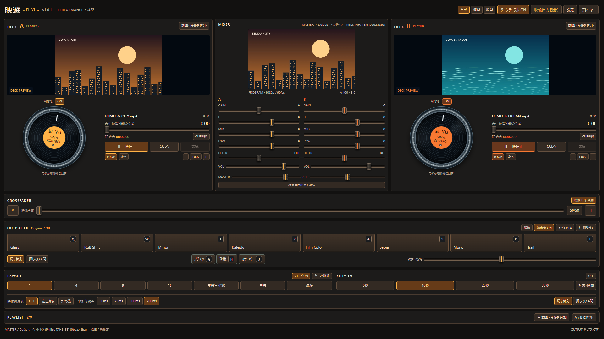
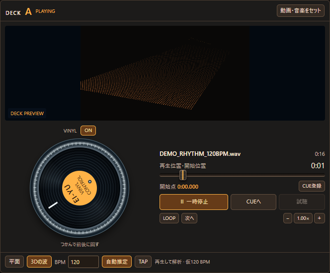
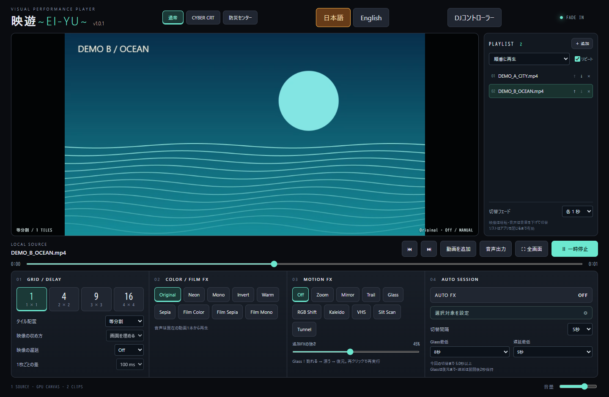

# 映遊 ~EI-YU~

Windows用のローカル動画・音楽ビジュアルDJプレーヤーです。2つのデッキで素材を再生し、エフェクトや画面分割を組み合わせて映像を演出できます。

## ダウンロードと起動

1. このページの **Releases** を開きます。
2. 最新版の **Assets** から `EI-YU-1.0.1-windows-x64.zip` をダウンロードします。
3. ZIPを展開し、`EI-YU-1.0.1-portable.exe` をダブルクリックします。
4. 「＋ 動画・音楽を追加」で自分のPCにあるファイルを読み込みます。

インストールやNode.jsの準備は不要です。初回起動は展開に少し時間がかかります。スクリーンショット付きの日本語PDF説明書をZIPに同梱しています。

## 主な機能

- 2デッキ再生、CUE登録、ヘッドホン試聴、クロスフェーダー
- MASTERとCUEの音声出力機器を個別に選択
- ターンテーブル表示とスクラッチ
- 画面分割、サイズ違いのタイル配置、映像の遅延
- Glass、RGB Shift、フィルム風、セピア、残像などの映像効果
- プチュン、砂嵐、カラーバーのテレビ演出
- 対象を選べるAuto FXとキーボード操作
- コントローラーと本番映像を別ウィンドウに表示
- MP3・WAVなどの音楽に反応する平面スペクトラムと3Dの波
- プレイリスト再生とシンプルなプレーヤーモード
- 日本語・英語の表示切り替え

## 最初の音声設定

「設定」で **MASTER** に本番スピーカーやUSB DAC、**CUE** に別のヘッドホン機器を選び、「音声出力を適用」を押します。試聴したいデッキの「試聴」をONにし、そのデッキを再生してください。

プレーヤーモードには専用の「音声出力」ボタンがあります。

## 映像を別の画面へ出す

「映像出力を開く」を押し、開いたウィンドウを外部モニターへ移動します。ダブルクリックまたはF11で全画面表示、Escで戻ります。

## ファイルと設定

- Windows x64用のポータブル版です。
- 動画はMP4（H.264 / AAC）、音楽はMP3・WAVなどを利用できます。実際の対応可否はファイル内の形式によって異なります。
- 動画・音楽は同梱していません。画像内の素材は説明用のデモです。
- プレイリストとCUE位置は終了するとクリアされます。
- 処理速度はPC、素材、画質、エフェクトの組み合わせによって変わります。

## 不具合の報告

このページの **Issues** から、アプリのバージョン、Windowsのバージョン、再現手順を添えてお知らせください。

---

## English

**EI-YU** is a Windows visual DJ player for local video and audio files. It provides two decks, headphone monitoring, audio crossfading, visual effects, tiled layouts, and a separate video output window.

Download the Windows x64 ZIP from **Releases → Assets**, extract it, and run the portable EXE. No Node.js setup is required. Select **Settings → Language → English** for the English interface.

The download includes a Japanese illustrated PDF manual. Add your own media files; demo media is not included. Playlists and CUE points are cleared when the app closes.
